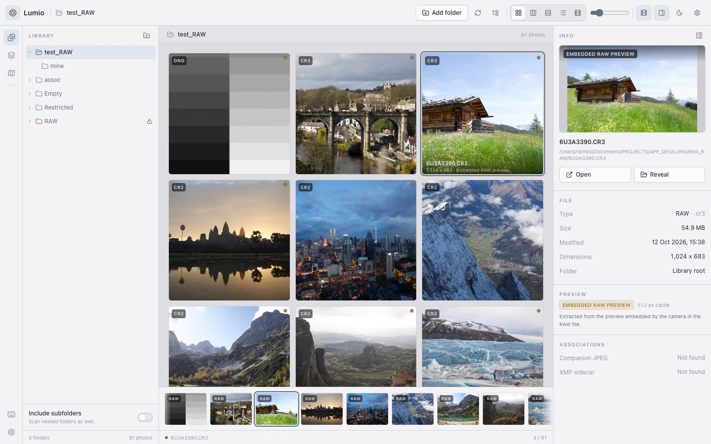

# Lumio

Lumio is a local-first browser for RAW photography. Point it at folders that already
contain photos and it shows them in place — nothing is imported, moved, renamed, or
modified. It is built with Rust, Tauri 2, Vue 3 and TypeScript.

This is **Milestone 1**: fast, correct folder-based browsing with honest preview-source
labelling. Cataloguing, search, metadata editing and sidecar writing come later.



## What works

- Add library folders with the native folder picker, and remove them again.
- Right-click any folder to create a subfolder inside it or open the same removal choices.
- Refresh the selected folder from the library header, or refresh a single folder from its
  right-click menu without rescanning the rest of the library.
- Every folder row offers the same two actions: remove it from the library (files stay on disk) or
  move it to the system Trash. Hidden subfolders can be restored by adding them again.
- Browse a real nested folder tree, loaded lazily as you expand it.
- Scan the current folder, or include every subfolder recursively.
- View photos in five layouts: grid, masonry, justified, list and filmstrip. The bottom
  navigation strip belongs to the filmstrip view; grid, masonry, justified and list stay
  strip-free.
- Select one or many photos: click, ⌘/Ctrl-click to toggle, Shift-click for a range,
  ⌘/Ctrl+A to select all, Shift+arrows to extend and Escape to clear.
- Drag any selected photo — or a single unselected photo — onto a folder row to move the
  whole group, including its companion JPEG, XMP sidecar and extra associations. Moves work
  between registered library roots and refuse to overwrite existing files.
- Delete photos from the library only or from disk, from the toolbar, the info panel, the
  Delete key, or by right-clicking a photo. Disk deletion moves every associated file to the
  system Trash after an explicit warning; library-only deletion hides the group and can be
  reversed in Settings → Hidden photos.
- Double-click any thumbnail to open it in filmstrip view.
- See photo counts beside every folder in the tree; counts follow the Include subfolders setting.
- Companion JPEG and XMP associations are shown as badges in list view and the info panel.
  Toggle **Assoc.** in the list header to reveal every associated JPG and XMP file as indented,
  connected rows beneath the RAW they belong to.
- Open any photo in a distraction-free fullscreen viewer from the info panel, the filmstrip
  view, or with the keyboard.
- Associate RAW + JPEG pairs and XMP sidecars that already exist next to the originals.
- See exactly where each preview came from: original image, companion JPEG, camera-embedded
  RAW preview, or a placeholder when none can be extracted.
- Light and dark themes, a unified teal accent palette, adjustable panels, thumbnail size and
  keyboard shortcuts.
- Settings for the Avenir interface font, bundled JetBrains Mono, and text size.
- Scan, permission and per-file errors are surfaced without hiding the rest of the folder.

## Non-destructive by default

Browsing is strictly read-only:

- No original file is ever copied, moved, renamed or written to while browsing.
- Thumbnails are written to the application cache directory, never beside your photos.
- XMP sidecars are detected and associated, but never parsed or modified yet.
- Removing a folder from Lumio only hides it in the app; files on disk are untouched. Hidden
  subfolders can be restored with Add Folder.
- Dragging photos between folders and deleting photos are explicit actions. Both expand the
  photo into its primary file, companion JPEG, XMP sidecar and any extra associated files.
  Moves refuse to overwrite an existing destination, and a failed batch is rolled back where
  possible. Cross-volume moves fall back to copy-then-remove.
- Delete from library only hides the photo group in Lumio. Every file stays on disk and the
  group can be restored from Settings → Hidden photos.
- The optional Delete from disk action moves a photo group, root or subfolder to the system
  Trash, where it can still be restored. It requires acknowledging a warning, and Lumio refuses
  filesystem roots, home folders, system folders, mount points, hidden/package folders and paths
  that overlap another registered library folder.
- New folders are created directly inside the right-clicked folder. Names that are empty, hidden,
  contain path separators, colons or control characters, or collide with an existing folder are
  rejected.

## Requirements

- macOS 12 or newer (primary), or a Linux desktop with WebKitGTK (secondary).
- Rust 1.85+ (edition 2024).
- Node.js 20.19+ or 22.12+, and pnpm.

Windows is not a target for Milestone 1.

## Development

```bash
pnpm install
pnpm tauri dev
```

The Vite dev server runs on port 1420 and the Tauri shell loads it automatically.

### Tests and checks

```bash
cargo test -p lumio-core     # Rust domain tests
pnpm test                    # frontend unit tests
pnpm exec vue-tsc --noEmit   # frontend type-check
pnpm build                   # type-check + production frontend build
cargo check -p lumio         # Tauri shell type-check
```

### Production build

```bash
pnpm tauri build
```

The macOS bundle is written to `target/release/bundle/`. The build is unsigned and
unnotarised; it is intended for personal use.

If macOS refuses to create the DMG with a Finder automation error, allow your terminal
to control Finder under System Settings → Privacy & Security → Automation, or build
just the `.app` with `pnpm tauri build --bundles app`.

## How previews work

Lumio deliberately separates the bytes it displays from the original:

1. If a companion JPEG exists next to the RAW file, it is used.
2. Otherwise the largest camera-embedded preview is extracted from the RAW with
   [`rawler`](https://github.com/dnglab/dnglab). No full RAW demosaic happens in M1.
3. If neither exists, the tile shows an honest placeholder instead of a broken image.

The preview source is shown on the tile, in the info panel and in the fullscreen viewer.
Images are resized with a box filter into a bucketed, content-addressed thumbnail cache
under the OS application cache directory.

## Project layout

```
crates/lumio-core/      Domain logic, testable without Tauri
  src/config.rs         Atomic JSON settings and library roots
  src/assets.rs         Asset file groups, safe moves, Trash and hidden groups
  src/scan.rs           Folder scanning, RAW/JPEG/XMP association, folder tree
  src/preview.rs        Camera-embedded preview extraction + orientation
  src/thumbnail.rs      Thumbnail cache keys, resizing, encoding
  src/path_utils.rs     Canonicalisation and filesystem metadata helpers
src-tauri/              Thin Tauri shell: state, commands, window setup
src/                    Vue 3 frontend
  components/           Shell, panels, dialogs, viewer
  views/                The five photo layouts
  stores/library.ts     Central application state
  lib/                  Pure layout, selection and formatting helpers (unit-tested)
docs/adr/               Architecture decision records
```

The Rust core owns filesystem behaviour and is independent of Tauri, so it can be tested
headlessly. The Tauri layer only resolves app paths, validates every path sent from the
webview against registered roots, and runs blocking work off the UI thread.

## Milestone 1 scope

In scope: folder roots, nested tree, scanning, association, five views, fullscreen,
preview-source indication, error handling, settings, tests and documentation.

Explicitly deferred: SQLite catalogue, search and filtering, ratings/labels/keywords,
XMP parsing or writing, editing, importing, cloud sync, HEIC/AVIF, map and albums.

## Configuration and data locations

| Data | Location |
| --- | --- |
| Library roots and UI settings | `~/Library/Application Support/com.lumio.desktop/settings.json` |
| Thumbnail cache | `~/Library/Caches/com.lumio.desktop/thumbnails/` |

On Linux these follow the XDG config/cache directories. Deleting the cache is always safe;
Lumio rebuilds previews on demand. A corrupt settings file is preserved with a
`.corrupt-<timestamp>` suffix and Lumio starts with an empty library rather than failing.

## Licence

Lumio is free software licensed under the **GNU General Public License v3.0 or later**
(`GPL-3.0-or-later`). See [LICENSE](LICENSE).
